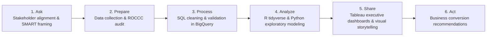

# 📊 Google Data Analytics Professional Study Hub & Code Repository

<div align="center">

### **🏆 Official 9-Course Specialization — 100% Grade Perfection**

[](https://www.coursera.org/account/accomplishments/specialization/QSQO1MHW9S3U)
[](https://www.coursera.org/account/accomplishments/specialization/QSQO1MHW9S3U)
[](https://cloud.google.com/bigquery)
[](https://www.r-project.org/)
[](https://python.org)
[](https://www.tableau.com/)

**Learner:** Eng. Ahmed Rifai  
**License:** Kiron Open Higher Education Coursera License  
**Comprehensive Study Guide:** [📖 Read the Complete Data Analytics Study Guide](STUDY_GUIDE.md)

</div>

---

## 📌 Repository Overview

This repository serves as a professional study hub, data engineering reference, and case-study portfolio for the **Google Data Analytics Professional Certificate**. It documents the end-to-end analytics workflow across spreadsheets, SQL data manipulation in Google BigQuery, statistical programming in R (`tidyverse`), exploratory data analysis in Python, and dashboard storytelling in Tableau.

> [!NOTE]
> All binary credential certificates and verification proofs are officially archived in Google Drive and verified via official Coursera credential IDs. This repository focuses strictly on high-yield technical artifacts: structured coursework, reusable Python modules in `src/`, SQL query templates, R scripts, and analytical study guides.

---

## 🏗️ Analytics Workflow Blueprint



---

## 📚 Curriculum & Course Breakdown

| # | Course Title | Score | Focus Areas | Official Verification |
|:---:|:---|:---:|:---|:---:|
| **01** | Foundations: Data, Data, Everywhere | **100%** | Data ecosystems, analytical thinking, data life cycle | [P47BRSFDL9HU](https://www.coursera.org/account/accomplishments/verify/P47BRSFDL9HU) |
| **02** | Ask Questions to Make Data-Driven Decisions | **100%** | SMART questions, problem formulation, stakeholder metrics | [8P2UW6XRBSYT](https://www.coursera.org/account/accomplishments/verify/8P2UW6XRBSYT) |
| **03** | Prepare Data for Exploration | **100%** | Data types, database schemas, ROCCC integrity, data ethics | [S9JDG9MYPRT6](https://www.coursera.org/account/accomplishments/verify/S9JDG9MYPRT6) |
| **04** | Process Data from Dirty to Clean | **100%** | SQL data cleaning, string parsing, duplicate elimination | [YJ99U4VYA7G2](https://www.coursera.org/account/accomplishments/verify/YJ99U4VYA7G2) |
| **05** | Analyze Data to Answer Questions | **100%** | Complex SQL queries, subqueries, aggregates, window functions | [G8M5FHJ12H91](https://www.coursera.org/account/accomplishments/verify/G8M5FHJ12H91) |
| **06** | Share Data Through the Art of Visualization | **100%** | Tableau visual design, preattentive attributes, storytelling | [EZXG4GB3IAZ7](https://www.coursera.org/account/accomplishments/verify/EZXG4GB3IAZ7) |
| **07 (R)** | Data Analysis with R Programming | **100%** | Tidyverse (`dplyr`, `ggplot2`, `tidyr`, `readr`), pipes (`%>%`) | [VH868ASXMQGV](https://www.coursera.org/account/accomplishments/verify/VH868ASXMQGV) |
| **07 (Py)** | Introduction to Data Analysis Using Python | **100%** | Pandas DataFrames, NumPy, Seaborn/Matplotlib visualization | [Python Track](Course%207%20(Python%20Track)%20-%20Introduction%20to%20Data%20Analysis%20Using%20Python/) |
| **08** | Google Data Analytics Capstone Project | **100%** | Cyclistic Bike-Share Case Study (Membership conversion analysis) | [HGKWH2RYX02S](https://www.coursera.org/account/accomplishments/verify/HGKWH2RYX02S) |
| **09** | Accelerate Your Job Search with AI | **100%** | AI-assisted portfolio positioning, resume optimization | [10U6ZB24AASN](https://www.coursera.org/account/accomplishments/verify/10U6ZB24AASN) |
| 🎓 | **Full Professional Certificate Credential** | **100%** | **Google Data Analytics Master Credential** | [QSQO1MHW9S3U](https://www.coursera.org/account/accomplishments/specialization/QSQO1MHW9S3U) |

---

## 📂 Repository Structure

```text
├── STUDY_GUIDE.md                     # Comprehensive theoretical, SQL & R study guide
├── README.md                          # Repository overview & verification index
├── .gitignore                         # Excludes cache & certificate binaries
├── src/
│   └── google_data_analytics/
│       ├── __init__.py                # Package initialization
│       ├── eda_pipeline.py            # Automated data profiling & outlier detection
│       └── sql_analytics.py           # BigQuery analytical query templates & window functions
├── Course 1-Foundations.../           # Course 1 Study Materials
├── Course 2-Ask Questions.../         # Course 2 Exercises
├── Course 3-Prepare Data.../          # Course 3 Data Integrity Assets
├── Course 4-Process Data.../          # Course 4 SQL Data Cleansing Scripts
├── Course 5-Analyze Data.../          # Course 5 Analytical SQL Queries
├── Course 6-Share Data.../            # Course 6 Tableau Visualizations
├── Course 7-Data Analysis with R.../  # Course 7 R Scripts & Notebooks
├── Course 7 (Python Track)...         # Course 7 Python EDA Labs
├── Course 8-Google Data Analytics.../ # Course 8 Cyclistic Bike-Share Capstone
└── Course 9-Accelerate Your Job.../   # Course 9 Portfolio Assets
```

---

## 🚀 Quickstart & Analytics Toolkit

### Installation
```bash
git clone https://github.com/Eng-Ahmed-Rifai/Google-Data-Analytics-Professional-Certificate.git
cd Google-Data-Analytics-Professional-Certificate
python -m venv .venv
source .venv/bin/activate  # On Windows: .venv\Scripts\activate
pip install pandas numpy matplotlib seaborn
```

### 1. Automated Data Quality Audit
```python
import pandas as pd
from google_data_analytics.eda_pipeline import DataQualityAudit

df = pd.read_csv("sample_data.csv")
auditor = DataQualityAudit(df)
profile = auditor.summary_profile()
print(f"Total records: {profile['total_records']}, Duplicates: {profile['duplicate_rows']}")
```

### 2. SQL Rolling Average Query Builder
```python
from google_data_analytics.sql_analytics import BigQueryAnalyticsTemplates

query = BigQueryAnalyticsTemplates.rolling_average_query(
    table_name="project.dataset.daily_metrics",
    date_col="report_date",
    metric_col="active_users",
    window_days=7
)
print(query)
```

---

## 👤 Author
**Eng. Ahmed Rifai**  
*Data Analyst & AI Engineer*  
GitHub: [@Eng-Ahmed-Rifai](https://github.com/Eng-Ahmed-Rifai)
