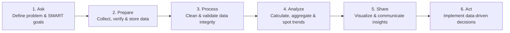

# 📊 Google Data Analytics Professional Certificate — Comprehensive Study Guide

**Author:** Eng. Ahmed Rifai  
**Credential:** [QSQO1MHW9S3U](https://www.coursera.org/account/accomplishments/specialization/QSQO1MHW9S3U) (Verified 100% Mastery across all 9 Courses)  
**Target:** Data Lifecycle Methodology, SQL & R Cheat Sheets, Python EDA, Tableau Visual Principles, and Capstone Framework for Lifelong Analytical Reference.

---

## 📑 Table of Contents
1. [The 6-Phase Google Data Analysis Lifecycle](#the-6-phase-google-data-analysis-lifecycle)
2. [Data Preparation & Data Governance](#data-preparation--data-governance)
3. [SQL for Data Analytics Mastery (BigQuery)](#sql-for-data-analytics-mastery-bigquery)
4. [Spreadsheet Modeling & Advanced Formulas](#spreadsheet-modeling--advanced-formulas)
5. [Statistical Computing with R & Tidyverse](#statistical-computing-with-r--tidyverse)
6. [Python for Exploratory Data Analysis (EDA)](#python-for-exploratory-data-analysis-eda)
7. [Data Visualization Principles & Tableau](#data-visualization-principles--tableau)
8. [Capstone Case Study Framework (Cyclistic Bike-Share)](#capstone-case-study-framework-cyclistic-bike-share)

---

## The 6-Phase Google Data Analysis Lifecycle



1. **Ask**: Define the problem statement, align with stakeholders, and formulate **SMART** questions (Specific, Measurable, Action-oriented, Relevant, Time-bound).
2. **Prepare**: Determine data sources (first-party, second-party, third-party), assess data formats (CSV, JSON, SQL tables), and evaluate credibility via the **ROCCC** metric:
   - **R**eliable (accurate and complete).
   - **O**riginal (validated primary source).
   - **C**omprehensive (sufficient sample size without major gaps).
   - **C**urrent (up-to-date and relevant).
   - **C**ited (trustworthy author/organization).
3. **Process**: Identify dirty data, handle anomalies, treat missing values, verify data types, and document transformation steps.
4. **Analyze**: Perform descriptive statistics (mean, median, mode, standard deviation), group data, join disparate sources, and uncover correlations.
5. **Share**: Create compelling visual narratives, interactive dashboards, and executive slide decks tailored to technical and non-technical stakeholders.
6. **Act**: Formulate clear, evidence-based recommendations that guide strategic business decisions.

---

## Data Preparation & Data Governance

### 1. Data Types & Classifications
- **Structured**: Relational database tables (SQL), spreadsheets.
- **Unstructured**: Video, audio, free text, emails.
- **Variables**:
  - **Qualitative (Categorical)**: Nominal (unordered labels: Gender, Color) vs Ordinal (ranked labels: High, Medium, Low).
  - **Quantitative (Numerical)**: Discrete (countable: number of website visits) vs Continuous (measurable: temperature, trip duration).

### 2. Identifying & Mitigating Data Bias
- **Sampling Bias**: Sample not representative of the target population.
- **Observer Bias**: Subjectivity in recording measurements.
- **Confirmation Bias**: Cherry-picking data to support a preconceived hypothesis.
- **Survivorship Bias**: Focusing only on successful entities that passed a selection process.

---

## SQL for Data Analytics Mastery (BigQuery)

### 1. Advanced Query Anatomy
```sql
SELECT
    station_id,
    user_type,
    COUNT(ride_id) AS total_trips,
    ROUND(AVG(trip_duration_minutes), 2) AS avg_duration,
    ROW_NUMBER() OVER(PARTITION BY user_type ORDER BY COUNT(ride_id) DESC) as popularity_rank
FROM
    `cyclistic_data.trips_2026`
WHERE
    trip_duration_minutes > 1 AND trip_duration_minutes < 1440
GROUP BY
    station_id, user_type
HAVING
    total_trips >= 100
ORDER BY
    popularity_rank ASC;
```

### 2. Critical Analytical SQL Techniques
- **Window Functions**: `AVG(col) OVER(PARTITION BY group_col ORDER BY date_col ROWS BETWEEN 6 PRECEDING AND CURRENT ROW)`.
- **Conditional Logic**: `CASE WHEN trip_duration > 60 THEN 'Long' ELSE 'Standard' END`.
- **String Cleaning**: `TRIM(col)`, `UPPER(col)`, `LOWER(col)`, `SUBSTR(col, 1, 10)`, `REGEXP_CONTAINS(col, r'^[A-Z0-9._%+-]+@[A-Z0-9.-]+\.[A-Z]{2,}$')`.
- **Date/Time Operations**: `DATE_DIFF(end_time, start_time, MINUTE)`, `EXTRACT(DAYOFWEEK FROM start_time)`.
- **CTEs (Common Table Expressions)**: Keep queries modular and readable using `WITH CleanedData AS (...)`.

---

## Statistical Computing with R & Tidyverse

### 1. Tidyverse Workflow
- **`readr`**: High-performance data ingestion (`read_csv`).
- **`tidyr`**: Reshaping datasets (`pivot_longer()`, `pivot_wider()`).
- **`dplyr`**: The grammar of data manipulation:
  - `filter()`: Pick observations by values.
  - `select()`: Pick variables by names.
  - `mutate()`: Add new variables that are functions of existing ones.
  - `summarise()`: Collapse many values down to a single summary.
  - `arrange()`: Reorder rows.
- **The Pipe Operator `%>%`**:
  ```r
  library(tidyverse)

  cyclistic_summary <- trips_df %>%
    filter(trip_duration_mins > 0) %>%
    group_by(member_casual, day_of_week) %>%
    summarise(
      mean_duration = mean(trip_duration_mins, na.rm = TRUE),
      number_of_rides = n()
    ) %>%
    arrange(member_casual, desc(number_of_rides))
  ```

### 2. Data Visualization with `ggplot2`
```r
ggplot(data = cyclistic_summary, aes(x = day_of_week, y = number_of_rides, fill = member_casual)) +
  geom_col(position = "dodge") +
  scale_y_continuous(labels = scales::comma) +
  labs(
    title = "Cyclistic: Weekly Ride Frequency by User Segment",
    subtitle = "Annual members exhibit weekday commuting peaks vs casual weekend leisure peaks",
    x = "Day of the Week",
    y = "Total Number of Rides",
    fill = "Membership Type"
  ) +
  theme_minimal()
```

---

## Data Visualization Principles & Tableau

### 1. Visual Encodings & Hierarchy
- **Preattentive Attributes**: Motion, color, shape, size, spatial position.
- **Rule of Thirds & Layout**: Key KPI scorecard at the top-left; detailed trends in the center; categorical distribution/breakdowns on the right.
- **Color Discipline**: Limit palette to 3-5 colors. Use color to encode meaningful categorical differences or quantitative gradients (avoid rainbow palettes).

### 2. Tableau Core Architecture
- **Blue vs Green**: Blue = Discrete (creates headers / categories); Green = Continuous (creates axes / measures).
- **Calculated Fields**:
  - `IF [Trip Duration] > 45 THEN 'Overtime' ELSE 'Standard' END`
  - Level of Detail (LOD) Expressions: `{FIXED [Customer ID] : MIN([Order Date])}` to identify customer acquisition cohorts.

---

## Capstone Case Study Framework (Cyclistic Bike-Share)

1. **Business Task**: Convert casual riders into profitable annual members by understanding how their usage patterns differ.
2. **Key Findings**:
   - **Members**: Use bikes for daily commuting (peaks at 8:00 AM and 5:00 PM Monday through Friday, with consistent 12-minute average duration).
   - **Casual Riders**: Use bikes primarily on weekends for recreation (peaks Saturday/Sunday afternoon, with longer average duration: 25-35 minutes).
3. **Data-Driven Strategy**:
   - Launch targeted digital marketing campaigns on Friday afternoons highlighting weekend member perks.
   - Introduce seasonal summer-pass promotions that credit casual ride costs toward an annual membership.
